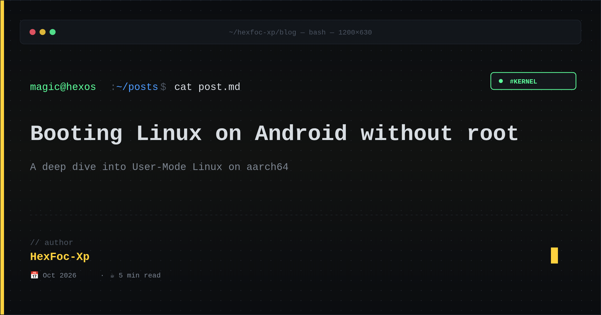
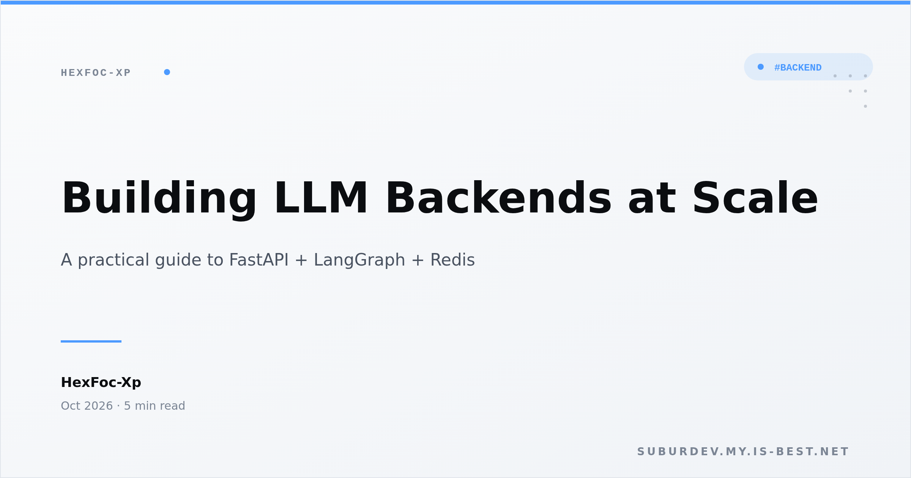
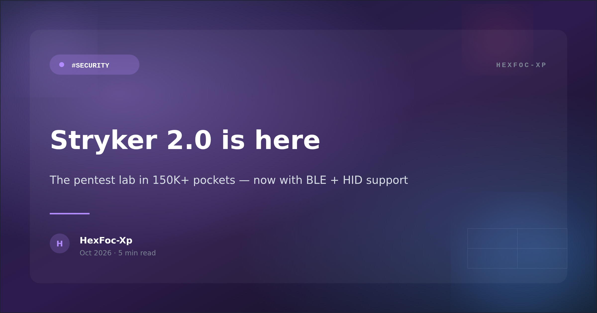

# 🖼️ OG Image Generator

<p align="center">
  
</p>

<p align="center">
  <sub>Generate beautiful Open Graph (OG) images for your blog posts, tutorials, and announcements — in 3 different styles.</sub>
</p>

<p align="center">
  <a href="LICENSE"></a>
  
  
  <a href="https://pypi.org/project/og-image-hexfoc/"></a>
</p>

---

## ✨ Features

- 🎨 **3 built-in templates** — `terminal`, `minimal`, `gradient`
- 📐 **Standard OG dimensions** (1200×630) — works on Twitter, Facebook, Telegram, Discord, WhatsApp, LinkedIn
- 🎯 **CLI + Python library** — use as a command-line tool or import as a module
- 🚀 **SVG-first rendering** — crisp output at any resolution via Playwright + Chromium
- 🔧 **Customizable** — override accent color, change author, swap templates
- 📦 **PyPI package** — `pip install og-image-hexfoc` and you're ready
- 🇮🇩 **Made in Indonesia** — by [HexFoc-Xp](https://github.com/HexFoc-Xp)

---

## 📦 Templates

### 1. `terminal` — dark cyberpunk terminal

Matches the [HexFoc-Xp profile README](https://github.com/HexFoc-Xp) aesthetic.
Best for: technical blog posts, kernel/security content, dev tutorials.

<p align="center">
  
</p>

### 2. `minimal` — clean white with sans-serif

Modern, professional, lots of whitespace.
Best for: corporate blog posts, tutorials, announcements.

<p align="center">
  
</p>

### 3. `gradient` — vibrant glassmorphism card

Modern startup-style with gradient background + glassmorphism card.
Best for: product launches, announcements, portfolio highlights.

<p align="center">
  
</p>

---

## 🚀 Quick Start

### Install (recommended — desktop)

```bash
pip install og-image-hexfoc
```

That's it. Now `og-image` is available as a CLI command and `og_image_hexfoc` is importable as a Python library.

The default renderer is **cairosvg** (pure Python, no Chromium download needed, works on every platform). If you want higher quality rendering with per-glyph font fallback, install the optional `playwright` extra:

```bash
pip install og-image-hexfoc[playwright]
playwright install chromium   # one-time, downloads Chromium (~150 MB)
```

### 📱 Install on Termux (Android)

The package is fully compatible with Termux! Playwright is **not available on Android**, but cairosvg works perfectly.

```bash
# In Termux, first install system dependencies for cairosvg:
pkg update
pkg install python libcairo cairo-png libjpeg-turbo libpng

# Then install the package:
pip install og-image-hexfoc

# Verify it works:
og-image --title "Hello from Termux!" --template terminal --output test.png
ls -la test.png
```

If you hit any `libcairo` issues during `pip install cairosvg`, run:
```bash
pkg install libxml2 libxslt
pip install --upgrade pip
pip install og-image-hexfoc
```

### Install from source (for development)

```bash
git clone https://github.com/HexFoc-Xp/og-image-generator.git
cd og-image-generator
pip install -e ".[dev]"
```

### CLI Usage

```bash
og-image \
    --title    "Booting Linux on Android without root" \
    --subtitle "A deep dive into User-Mode Linux on aarch64" \
    --author   "HexFoc-Xp" \
    --date     "Oct 2026" \
    --tag      "kernel" \
    --template terminal \
    --output   out.png
```

**Output:**
```
wrote out.png (160 KB)
```

### Library Usage

```python
from og_image_hexfoc import generate

generate(
    title="My awesome blog post",
    subtitle="Short description here",
    author="HexFoc-Xp",
    date="Oct 2026",
    tag="backend",
    template="terminal",
    output="og.png",
)
```

### Generate All Examples

```bash
python scripts/demo.py
```

This generates 3 example PNGs in `examples/` — one per template.

---

## 🎛️ CLI Reference

| Flag | Required | Default | Description |
|---|---|---|---|
| `--title` | ✅ Yes | — | Main title (string) |
| `--subtitle` | ❌ No | `""` | Optional subtitle / description |
| `--author` | ❌ No | `HexFoc-Xp` | Author name |
| `--date` | ❌ No | `""` | Date string, e.g. `Oct 2026` |
| `--tag` | ❌ No | `""` | Tag, e.g. `kernel`, `security`, `backend` |
| `--template` | ❌ No | `terminal` | One of: `terminal`, `minimal`, `gradient` |
| `--accent` | ❌ No | (template default) | Override accent color (hex, e.g. `#ffd23f`) |
| `--width` | ❌ No | `1200` | Width in pixels |
| `--height` | ❌ No | `630` | Height in pixels |
| `--output` `-o` | ✅ Yes | — | Output PNG path |

### Tag Color Mapping (terminal template)

The `terminal` template auto-colors the tag badge based on the tag value:

| Tag | Color |
|---|---|
| `kernel` | 🟢 Green |
| `security` | 🔴 Red |
| `android` | 🟡 Yellow |
| `backend` | 🔵 Blue |
| `ai` | 🟣 Violet |
| `tutorial` | 🔵 Blue |
| *(other)* | 🟡 Default accent (yellow) |

---

## 🧱 Adding a Custom Template

Templates are plain Python modules in `templates/<name>.py`. Each must export a `render()` function:

```python
# templates/my_template.py
from html import escape

def render(*, title, subtitle="", author="HexFoc-Xp", date="", tag="",
           accent=None, width=1200, height=630) -> str:
    """Return an SVG string."""
    return f"""<svg xmlns="http://www.w3.org/2000/svg" width="{width}" height="{height}">
      <rect width="{width}" height="{height}" fill="#000"/>
      <text x="50" y="100" font-size="48" fill="#fff">{escape(title)}</text>
    </svg>"""
```

Then use it:

```bash
python og_image.py --title "Test" --template my_template --output out.png
```

That's it. The template file just needs to live in `templates/` and expose a `render()` function returning an SVG string.

---

## 🔧 How It Works

1. **SVG generation** — Each template returns an SVG string with the title/subtitle/metadata baked in.
2. **Render to PNG** — `og_image.render_svg()` writes the SVG to a temp file, opens it in headless Chromium (via Playwright), waits for fonts to settle, and takes a high-DPI screenshot (2x device scale).
3. **Output** — The final PNG is saved to your `--output` path.

**Why SVG → Chromium instead of pure Python (Pillow)?**

- **Per-glyph font fallback** — Chromium's text rendering handles mixed scripts (Latin + CJK + emoji) seamlessly.
- **CSS features** — `letter-spacing`, `font-weight`, gradients, filters, blur — all work out of the box.
- **Easy to template** — SVG is just XML; you don't need to think about canvas coordinate math.

If you don't want to install Chromium, you can fall back to `cairosvg` (see `requirements.txt`).

---

## 📁 Project Structure

```
og-image-generator/
├── README.md
├── LICENSE                  # MIT
├── requirements.txt
├── .gitignore
├── og_image.py              # CLI + core generator (entry point)
├── templates/
│   ├── terminal.py          # dark cyberpunk (HexFoc-Xp style)
│   ├── minimal.py           # clean white, sans-serif
│   └── gradient.py          # vibrant glassmorphism
├── scripts/
│   └── demo.py              # Generate all 3 examples
└── examples/
    ├── terminal-blog.png
    ├── minimal-tutorial.png
    └── gradient-launch.png
```

---

## 🌐 Integration Ideas

### Use with Next.js / Vercel

You can wrap this in a small FastAPI service and deploy to Vercel/Railway/Fly.io as an OG-image-as-a-service:

```python
# api/main.py (sketch)
from fastapi import FastAPI, Response
from og_image import generate
import io

app = FastAPI()

@app.get("/og.png")
def og(title: str, subtitle: str = "", tag: str = "blog"):
    out_path = generate(title=title, subtitle=subtitle, tag=tag,
                        template="terminal", output="/tmp/og.png")
    return Response(content=out_path.read_bytes(), media_type="image/png")
```

Then in your HTML `<head>`:

```html
<meta property="og:image"
      content="https://your-api.com/og.png?title=Hello+World&tag=blog" />
```

### Use with Hugo / Jekyll / Gatsby

Generate OG images as a build step:

```bash
# Build script
for post in content/posts/*.md; do
  title=$(head -1 "$post" | sed 's/# //')
  slug=$(basename "$post" .md)
  python og_image.py --title "$title" --output "static/og/$slug.png"
done
```

---

## 📋 Use Cases

- 📝 **Blog posts** — generate unique OG image per post, automatically
- 🎓 **Tutorials** — tag-based color coding (`#kernel`, `#security`, etc.)
- 🚀 **Product launches** — use `gradient` template for startup-style announcements
- 📚 **Documentation** — auto-generate OG images for each doc page
- 📰 **Newsletter** — unique preview image per newsletter issue

---

## 🤝 Contributing

Contributions welcome! Especially:

- 🎨 New templates (a `cyberpunk`, `newspaper`, `magazine` style would be great)
- 🌍 Internationalization (better CJK font handling)
- ⚡ Performance optimizations (cache Chromium instance, batch rendering)
- 🐛 Bug fixes

Open an issue first to discuss what you'd like to add.

---

## 📦 Publishing a new release (maintainer only)

This section is for repo maintainers (HexFoc-Xp) releasing new versions to PyPI.

### Prerequisites

1. **PyPI account** — register at https://pypi.org/account/register/
2. **API token** — https://pypi.org/manage/account/token/ (scope: "Entire account")
   - Save the token (`pypi-xxxxxxxxxxxxxxxxxxxx`) somewhere safe
3. **2FA enabled** (recommended) — https://pypi.org/manage/account/

### Steps to release a new version

```bash
# 1. Update version in pyproject.toml AND src/og_image_hexfoc/__init__.py
#    (they must match)
#    e.g. version = "0.2.0"

# 2. Clean previous builds
rm -rf dist/ build/ src/*.egg-info

# 3. Build sdist + wheel
python -m build

# 4. Verify the archives
twine check dist/*

# 5. Test upload to TestPyPI (optional but recommended)
#    Register at https://test.pypi.org/ if you haven't
twine upload --repository testpypi dist/*

# 6. Install from TestPyPI to verify
pip install -i https://test.pypi.org/simple/ og-image-hexfoc

# 7. Upload to real PyPI
twine upload dist/*

# 8. Tag the release on GitHub
git tag -a v0.2.0 -m "Release 0.2.0"
git push origin v0.2.0

# 9. Create a GitHub Release (Web UI or `gh release create`)
#    Attach the sdist + wheel from dist/ as release artifacts
```

### First-time setup: configure credentials

Create `~/.pypirc`:

```ini
[distutils]
index-servers =
    pypi
    testpypi

[pypi]
username = __token__
password = pypi-xxxxxxxxxxxxxxxxxxxxxxxxxxxxxxxx   # your real PyPI token

[testpypi]
username = __token__
password = pypi-xxxxxxxxxxxxxxxxxxxxxxxxxxxxxxxx   # your TestPyPI token
```

Set file permissions: `chmod 600 ~/.pypirc`

### Automated releases via GitHub Actions (optional)

You can automate the release process by adding a workflow that
triggers on git tags. See `.github/workflows/release.yml` (to be added).

---

## 📜 License

**MIT** — see [LICENSE](LICENSE). You're free to use, modify, distribute, even commercially, as long as you keep the copyright notice.

---

## 👤 Author

**HexFoc-Xp** 🇮🇩

- 🌐 Web: [suburdev-my.is-best.net](https://suburdev-my.is-best.net)
- 💬 Telegram: [@HexFoc_Xp](https://t.me/HexFoc_Xp)
- 💻 GitHub: [HexFoc-Xp](https://github.com/HexFoc-Xp)
- ☕ Donate: [saweria.co/HexFocXp](https://saweria.co/HexFocXp)

If this tool saved you time, consider [buying me a coffee ☕](https://saweria.co/HexFocXp).
